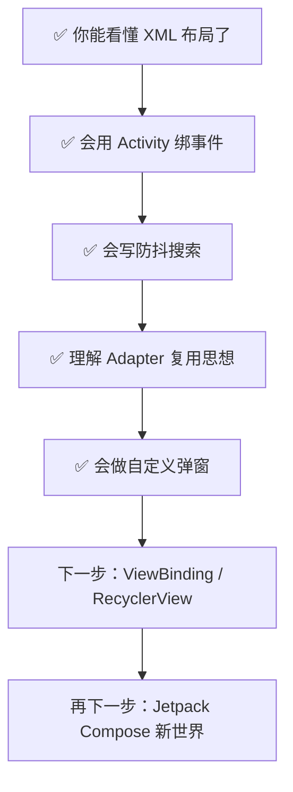

# 零基础版：安卓 App 前端实现教程（以 GlobalTraveling 为案例）

> 这份教程假设你**完全零基础**：没写过安卓、甚至不太清楚 App 界面是怎么来的。
> 每一节都遵循同一个讲法：**先说遇到什么问题 → 再说为什么用这个方案 → 最后看项目里的真实代码**。
>
> 配套精简版（适合二刷）：`docs/android-ui-tutorial.md`

---

## 第 0 章：先把 5 个最核心的概念说人话

在看任何代码之前，先建立世界观。忘掉术语，用一个类比：

| 概念 | 类比 | 说明 |
|---|---|---|
| **App（应用）** | 一家店 | 你安装到手机上的东西，本质是一个 `.apk` 文件，里面装着代码 + 图片 + 配置 |
| **Activity** | 店里的一个房间/页面 | 你看到的"一整屏"就是一个 Activity。本项目整个 App 只有一个 `MainActivity`，所以它一屏到底 |
| **View（控件）** | 房间里的一件家具 | 一个按钮、一段文字、一张图片，都叫 View |
| **ViewGroup（容器）** | 收纳箱/货架 | 它自己不显示内容，只用来**装别的 View**，决定它们怎么排列 |
| **布局（Layout）** | 房间的装修图纸 | 一份 XML 文件，描述"这个房间里家具怎么摆" |

再加一条铁律：

> **安卓的所有界面，本质上是一棵树（叫"视图树"）。**
> 屏幕只有一个根，每个控件都挂着一个"爹"（父容器），层层往下。

```
根 (ConstraintLayout)
├── MapView          ← 地图（最底层，铺满）
├── CardView         ← 搜索气泡
│   └── AutoCompleteTextView   ← 搜索输入框
├── HorizontalScrollView       ← 历史记录横条
│   └── LinearLayout
└── CardView         ← 底部按钮岛
    └── LinearLayout
        ├── 状态文字行
        └── 按钮行
```

**为什么要理解"树"？** 因为后面所有的操作——找控件（`findViewById`）、
改样式、计算大小——都是在**遍历这棵树**。树根动一下，下面全变。

---

## 第 1 章：为什么界面要用 XML 写，而不是直接写 Java？

### 问题

你可能会想：写代码不就行了，为什么多此一举搞一个 XML 文件？

### 答案：四个理由

**理由 1：界面是"描述性"的，不是"过程性"的。**

描述"这里有个 50dp 高的圆角搜索框"只要一句话；
而用代码画出来要指定宽、高、颜色、圆角、内边距、阴影……几十行。
XML 就是把"长什么样"用声明的方式一次说完。

**理由 2：不跑起来就能预览。**

Android Studio 打开 XML 右边直接显示界面草图。写 Java 你得编译、安装、打开手机才知道长啥样。

**理由 3：分工。**

改外观（颜色、间距）只碰 XML；改逻辑（点击后干什么）只碰 Java。
两边互不打扰，不会"改个按钮位置不小心弄坏点击功能"。

**理由 4：适配。**

安卓手机屏幕千奇百怪（大小、密度）。XML 里写 `50dp`，系统会自动换算成
每个屏幕合适的像素。你写一次，所有手机上都差不多大。

### 对应到代码

`MainActivity.onCreate` 里的这一行，是**连接 XML 和 Java 的桥梁**：

```java
setContentView(R.layout.activity_main);
```

逐词拆解：

- `R` —— 编译器自动生成的**资源总目录**。你每往 `res/` 里放一个文件，
  R 里就多一条登记（类似酒店的房间登记簿）。
- `R.layout.activity_main` —— 登记簿里 `layout` 分类下、名叫 `activity_main` 的那一条。
  注意这不是文件路径，只是一个**编号引用**。
- `setContentView(...)` —— "按这份图纸施工"。执行完这行，XML 才变成屏幕上真实的视图树。
- **为什么必须在 `findViewById` 之前调用？** 因为控件是施工时才诞生的。
  房子还没盖，你自然指认不了"二楼的灯"。

---

## 第 2 章：逐段拆解 `activity_main.xml`

文件位置：`app/src/main/res/layout/activity_main.xml`

### 2.1 根标签和 xmlns

```xml
<ConstraintLayout xmlns:android="http://schemas.android.com/apk/res/android"
    xmlns:app="http://schemas.android.com/apk/res-auto"
    android:layout_width="match_parent"
    android:layout_height="match_parent">
```

- **为什么必须有一个根标签？** XML 语法规定一份文档只能有一个最外层元素
  （树总得有个树根）。
- **`xmlns:android="..."` 是什么？** 一句话：**词典声明**。
  它告诉解析器"`android:` 开头的属性，请按安卓官方词典解释"。
  没有它，`android:text` 就是一串无意义的字符。
- **为什么还有个 `xmlns:app`？** 因为 `app:cardCornerRadius` 这类属性属于
  **安卓官方词典里没有的**——它们是第三方库（Material、CardView）带来的，
  所以要另开一本词典（`res-auto` = 自动找本项目依赖库的词典）。
- **`layout_width="match_parent"`** —— "跟我爹一样宽"，即撑满。
  另一个选项 `wrap_content` = "装多少内容就多大"。
  安卓尺寸只有这两个直觉答案，记住就够用了。

### 2.2 搜索框：为什么是"CardView 套 AutoCompleteTextView"两层？

```xml
<androidx.cardview.widget.CardView
    android:id="@+id/search_card"
    android:layout_height="50dp"
    app:cardCornerRadius="25dp"
    app:cardElevation="4dp"
    app:cardBackgroundColor="#F0F7FF">

    <AutoCompleteTextView
        android:id="@+id/et_search"
        android:background="@android:color/transparent" ... />
</androidx.cardview.widget.CardView>
```

**为什么要分两层？——职责分离。**

- 圆角、阴影、底色是"外观"，交给 `CardView`（它就干这个出身的）；
- 输入文字、弹联想列表是"功能"，交给 `AutoCompleteTextView`；
- 输入框本身背景设成透明，让下面的 CardView 露出来。

如果硬让一个控件同时干两件事，代码会又长又难改。
**安卓（乃至所有 UI 开发）的通用套路：容器负责美观，内容控件负责功能。**

**为什么选 `AutoCompleteTextView` 而不是普通 `EditText`？**
因为需求是"边输入边出联想"。它内置了下拉联想机制，
只要给它喂一个"数据适配器"（第 7 章讲），下拉列表自动就有了。
**选控件的思路：先有需求，再看系统自带控件能不能直接满足，不要重复造轮子。**

其他属性逐个说"为什么"：

| 属性 | 为什么这样写 |
|---|---|
| `android:id="@+id/et_search"` | `@+id/` 的 `+` 意思是"**新建**一个叫 et_search 的编号"。没有 id，Java 就找不到它（id 是给 Java 用的门牌号） |
| `android:hint="搜索地点"` | 占位提示：没字时显示灰字，一开始打字就消失——比额外放一个 TextView 省一个控件 |
| `android:drawableStart="@drawable/ic_search_line"` | 左侧放大镜图标。用 `@drawable`（引用，不带 `+`，因为图标早就存在） |
| `android:textSize="15sp"` | 字号用 **sp**（随用户系统字体缩放）；尺寸用 **dp**（不随字体变）。写错的后果：老人机用户开大字体后你的界面直接爆版 |
| `android:singleLine="true"` | 搜索词不该换行，一行到底 |
| `android:imeOptions="actionDone"` | 键盘右下角显示"完成"而不是"换行"——搜索框换行没有意义 |
| `android:layout_marginTop="60dp"` | 给状态栏/刘海屏留出空间，不然搜索框顶到屏幕外 |

### 2.3 历史记录：为什么外面套 `HorizontalScrollView`？

需求是"历史记录横着滑"。但 `LinearLayout` 本身不滚动，
**滑动是 ScrollView 家族的职责**——所以套一层：

```xml
<HorizontalScrollView>
    <LinearLayout android:orientation="horizontal" android:id="@+id/history_container" />
</HorizontalScrollView>
```

**为什么里面的容器叫 `history_container` 且留空？**
因为历史条目的数量运行时才知道（0 条、3 条、8 条……），
XML 写不了"未知数量"，所以这里只放一个**空箱子**，
具体箱子由 Java 往里塞（第 8 章讲）。这叫"**XML 定骨架，代码填肉**"。

### 2.4 底部按钮岛：`layout_weight` 为什么存在

```xml
<com.google.android.material.button.MaterialButton
    android:id="@+id/btn_stop"
    android:layout_width="0dp" android:layout_weight="1" ... />

<com.google.android.material.button.MaterialButton
    android:id="@+id/btn_start"
    android:layout_width="0dp" android:layout_weight="1.5" ... />
```

两个按钮要**瓜分同一行的宽度**，但瓜分比例是 1 : 1.5。
这时候宽度不能写死（写 `150dp` 在小屏上放不下、大屏上留白），
所以写 `0dp` + `weight`——**"宽度由权重说了算"**。
结果："开始模拟"（主操作）比"停止模拟"宽 50%，视觉上引导用户点它。
这是 UI 设计常识：**主按钮要比次按钮显眼**。

### 2.5 为什么根布局用 ConstraintLayout？

早期安卓要套很多层 `LinearLayout` 才能实现相对位置
（"A 在 B 下面、C 居中"），嵌套深了两大害处：
**测量慢**（每层都要量一遍）、**改不动**（动一个间距要连改三层）。
`ConstraintLayout` 用"约束"直接描述相对关系，**一层搞定**，
所以它成为现代项目的根布局首选。本项目：
历史条用 `constraintTop_toBottomOf="@+id/search_card"` 挂在搜索框下面——
搜索框挪到哪，历史条自动跟着，**这就是"约束"的意义**。

---

## 第 3 章：为什么所有素材都放 `res/`？直接写代码里不行吗？

### 3.1 图片/背景：为什么用 XML 画而不是贴 PNG？

`res/drawable/bg_search_dropdown.xml`（下拉框的白底圆角背景）：

```xml
<shape android:shape="rectangle">
    <solid android:color="#FFFFFF" />
    <corners android:radius="14dp" />
    <stroke android:width="1dp" android:color="#E3EDF9" />
</shape>
```

**为什么不切一张圆角 PNG？**

1. **体积**：这个文件不到 300 字节，PNG 可能要几 KB 还得做多套分辨率；
2. **清晰**：矢量描述在任何屏幕上都锐利，PNG 放大会糊；
3. **好改**：想改圆角？改一个数字 `14dp` 重新编译，而不是让设计师重新出图。

同理 `ic_search_line.xml` 是**矢量图标**（VectorDrawable）。
安卓世界里"能用 XML 画就别用位图"是一条经验法则。

### 3.2 主题 `themes.xml`：为什么状态栏颜色写在配置文件里？

```xml
<style name="Theme.Irest" parent="Theme.Material3.DayNight.NoActionBar">
    <item name="android:statusBarColor">@android:color/transparent</item>
    <item name="android:windowLightStatusBar">true</item>
</style>
```

**为什么要"主题"这个东西？——统一默认值。**

如果每个页面都自己写一遍状态栏颜色，十个页面就会写出十种样式，
总有一天不一致。主题 = **全局默认值清单**，一处声明，全 App 生效。

各词条的"为什么"：

- `parent="Theme.Material3..."`：主题是**可以继承**的。你不从零写，
  而是站在谷歌官方 Material3 主题的肩膀上，只覆盖你要改的几项
  （这也是为什么本项目大部分按钮样式是白送的）。
- `DayNight`：**自动适配深色模式**。用户开了深色模式你的 App 还是大白屏，
  会被骂。选带 DayNight 的父主题，系统自动帮你切。
- `NoActionBar`：本 App 第一屏是全屏地图，顶部再压一条标题栏很丑——
  所以**从主题层面关掉**，而不是每个页面去隐藏。
- `statusBarColor=transparent` + `windowLightStatusBar=true`：
  让状态栏透明（地图顶上去）、图标变黑（浅色地图上黑字才看得见）。
  全屏沉浸式界面的标准起手式。
- 在 `AndroidManifest.xml` 里通过 `android:theme="@style/Theme.Irest"`
  挂到整个 App——**为什么在 Manifest 挂？** 因为主题必须在 Activity
  创建**之前**就定好，Manifest 就是"开张前的规章制度"。

> ⚠️ 本项目踩过的坑（记住能少走弯路）：
> **主题必须前后一致。** 在 M3 主题的 App 里强行用 M2 样式的弹窗、
> 或者造一个"强制浅色"的 Context 再去弹窗，会因为找不到对应样式属性**直接闪退**。
> 正确姿势：正常弹出后再"重新粉刷"（第 9 章讲）。

### 3.3 为什么文字要抽到 `strings.xml`？

`res/values/strings.xml` 现在只有一行：

```xml
<string name="app_name">Shadow</string>
```

正式项目里所有用户可见文字都应放这里，原因：
**多语言**（出海要英文版时只翻译这个文件，不用全局搜代码）、
**集中改文案**（法务要求改一句话只动一处）。
本项目是个人工具，布局里直接写了 `android:text="开始模拟"`——
能跑，但养成习惯后你会感谢自己。

---

## 第 4 章：Activity 的一生——为什么要有 `onCreate` 这种东西？

### 4.1 根本原因：安卓会随时杀掉你的页面

手机内存紧张时，系统可能**悄悄杀掉后台的 Activity**；
用户旋转屏幕，系统会**销毁重建** Activity。
所以安卓设计了一组生命周期回调，明确告诉你：
"我要创建了/onCreate、我要可见了/onStart、我能交互了/onResume、
我要暂停了/onPause、我被销毁了/onDestroy"。

**规则：每个阶段该干的事放对应的回调里。**

- 初始化、读配置、绑事件 → `onCreate`（**只在创建时跑一次**，放这里最安全）
- 恢复地图/相机这种"活物" → `onResume`
- 暂停耗电的东西（定位、动画）→ `onPause`
- 释放资源 → `onDestroy`

### 4.2 看本项目的 onCreate，每一步都有"为什么"

```java
protected void onCreate(Bundle savedInstanceState) {
    // ① SDK 合规初始化
    MapsInitializer.updatePrivacyShow(this, true, true);
    MapsInitializer.updatePrivacyAgree(this, true);

    // ② 状态栏：透明 + 黑图标
    getWindow().setStatusBarColor(Color.TRANSPARENT);
    getWindow().getDecorView().setSystemUiVisibility(...);

    // ③ 铺图纸
    setContentView(R.layout.activity_main);

    // ④ 先过免责声明，再初始化业务
    if (checkDisclaimer()) initApp();
}
```

逐条问"为什么"：

- **① 为什么合规声明必须最前面？**
  国内法规要求地图类 SDK 在**采集任何数据/渲染任何内容之前**
  先让用户看到隐私政策。放晚了 = 违规，高德 SDK 可能直接不工作。
  **顺序本身就是功能的一部分。**
- **② 为什么在 `setContentView` 之前？**
  状态栏属于"窗口"，窗口在 Activity 一开始就存在了，
  而界面是后面才铺的。先改窗口，铺界面时就不会出现"一条白色闪缝"。
- **③ 为什么 `setContentView` 可以被调用两次？**
  本项目 `onCreate` 里一次、`initApp()` 里又一次——
  因为免责声明没同意前不铺正式界面，同意后再铺。
  这是刻意的"**先弹窗、后加载**"流程控制。
- **④ 为什么要"先同意才初始化"？** 用户没同意条款，
  就不该加载地图、发网络请求——既是合规，也是尊重。

### 4.3 为什么地图要在生命周期里"转发"？

```java
mapView.onCreate(savedState);   // 项目里还转发 onResume/onPause/onDestroy
```

`MapView` 不是普通控件，**它内部有自己的 GL 渲染线程**。
你不在 `onResume` 叫它"继续"，它就一直黑屏；
不在 `onDestroy` 叫它"释放"，它就泄漏显存。
**经验：凡是第三方"重量级控件"（地图、视频、相机），
文档都会要求你在生命周期里转发事件——照做，别偷懒。**

`savedState` 参数是干嘛的？系统销毁重建页面时会把当时的内存快照存进这个 Bundle 还给你。
**转交给地图 = 帮它恢复现场**（比如旋转屏幕后地图不回到初始视角）。

---

## 第 5 章：`findViewById` 和点击事件——为什么"先找到，再绑定"？

### 5.1 为什么不能直接操作控件？

XML 铺完后，控件只是存在于视图树里的对象，Java 里**没有变量指向它**。
类比：装修完了，但你手上没有房间钥匙，得先去前台"认领"。

```java
tvStatus = findViewById(R.id.tv_status);   // 认领：拿到钥匙
tvStatus.setText("已选: 西湖");             // 之后随便进屋操作
```

`findViewById` 就是"拿着门牌号（id）在树里遍历找人"，
找到后返回那个 View 对象。**找不到会返回 null**——
所以新手最常见的崩溃 `NullPointerException`，
九成是因为：**忘了 `setContentView` 就 findViewById**，
或者 **id 打错字**（id 是字符串，编译器不帮你查错，运行到才炸）。

### 5.2 点击事件的标准三段式

```java
findViewById(R.id.btn_start).setOnClickListener(v -> {
    if (selectLat == 0) {                                          // ① 校验
        Toast.makeText(this, "请先在地图上长按或搜索选点", Toast.LENGTH_SHORT).show();
        return;
    }
    writeToSystemTmp(selectLat + "," + selectLng + ",1," + ...);   // ③ 执行
    saveHistory(currentName, selectLat, selectLng);
});
```

**为什么必须是这个顺序？**

- **① 校验**：界面输入**永远不可信**。用户没选点就按"开始模拟"，
  如果不拦，就会把 `0,0` 这种垃圾坐标写进配置文件，造成后续一连串怪 bug。
  **在入口处把无效数据挡掉，是最便宜的 bug 修复。**
- **② 反馈（Toast）**：不给提示，用户以为按钮坏了，会狂点。
  **用户的每一个操作都必须有回应**——这是交互设计第一原则。
- **③ 执行**：校验通过才做正事。

**关于 lambda `v -> {...}`**：`v` 就是"被点的那个控件自己"。
本项目没用它，但如果你想"点谁就改谁的文字"，就靠它。

### 5.3 长按为什么 `return true`？

```java
tvStatus.setOnLongClickListener(v -> {
    showApiKeyDialog();
    return true;   // 告诉系统：我处理完了，别再把事件传给别人
});
```

安卓的事件像**击鼓传花**：控件处理完可以不接（返回 false），
花继续传给父容器。返回 `true` = "花到我这为止"。
不返回 true 的话，长按文字可能同时触发父容器的长按菜单。

---

## 第 6 章：防抖（Debounce）——为什么不能"每输入一个字就搜索"？

### 6.1 先算一笔账

用户想搜"西湖公园"，要敲 4 个字。
**无防抖**：敲 4 个字 = 发 4 次网络请求（"西"、"西湖"、"西湖公"、"西湖公园"），
前 3 次的结果用户根本来不及看就被覆盖，还可能被服务器限流封 IP。
**有防抖**：停止输入 600ms 后才发 1 次请求，只要最终结果。

类比等电梯：按一下按钮就行，狂按不会更快，只会让调度系统发懵。

### 6.2 实现思路：一把"会自动取消的定时器"

```java
etSearch.addTextChangedListener(new TextWatcher() {
    @Override public void onTextChanged(...) {
        // 每次新输入，先把上一个"600ms 后执行"的任务掐掉
        if (searchRunnable != null) searchHandler.removeCallbacks(searchRunnable);
    }
    @Override public void afterTextChanged(Editable s) {
        searchRunnable = () -> { /* 这里才真正发起搜索 */ };
        searchHandler.postDelayed(searchRunnable, 600);   // 重新定 600ms 后的闹钟
    }
});
```

- `TextWatcher` = 文本变化监听器（`before/on/after` 三个时机，
  只有 `after` 是"字已经变了"，所以逻辑放那）；
- `Handler.postDelayed(runnable, 600)` = "600ms 后帮我跑这段代码"；
- `removeCallbacks` = "刚才那个闹钟作废"。

**为什么这样就等效于"停止输入 600ms 才执行"？**
因为每次按键都会**重置**闹钟，只有当用户真的停手超过 600ms，
闹钟没被取消，才会响。**防抖是所有搜索框/自动保存/联想框的标配**，务必掌握。

---

## 第 7 章：适配器（Adapter）——用餐厅类比讲清它到底干嘛

### 7.1 问题：为什么搜索联想不能用 XML 直接写？

用户搜"西"可能出 5 条联想，搜"西湖公园"可能出 1 条，也可能 0 条。
**数量在运行之前不知道**，而 XML 是写死的——写不了"未知数量"。

解法：**模板 + 数据 + 一个搬运工**。

| 角色 | 本项目对应 | 餐厅类比 |
|---|---|---|
| 模板（长什么样） | `item_search_tip.xml`（一个空的双行条目） | 空餐盘 |
| 数据（装什么） | `Tip` 对象（名字 + 地址 + 坐标） | 菜 |
| 搬运工（把菜装进盘子） | **`TipAdapter`** | 传菜员 |

**Adapter 的唯一职责：拿一条数据，造一个对应的 View。**
系统（AutoCompleteTextView）负责显示和滚动，它只管不停地问 Adapter 要"第 N 行"。

### 7.2 逐行读 `TipAdapter`

```java
private class TipAdapter extends ArrayAdapter<Tip> {

    @Override public View getView(int position, View convertView, ViewGroup parent) {
        return buildRow(position, convertView, parent);
        // getView = "给我第 position 行的样子"（输入框里当前显示的那条）
    }

    @Override public View getDropDownView(int position, View convertView, ViewGroup parent) {
        return buildRow(position, convertView, parent);
        // getDropDownView = 下拉列表里每一行的样子
        // 为什么要两个方法？因为"输入框里显示的"和"下拉列表里的"
        // 在系统眼里是两个不同的位置，可能要长得不一样
    }

    private View buildRow(int position, View convertView, ViewGroup parent) {
        View view = convertView;
        if (view == null) {   // ★ 核心：没有旧盘子才去洗新盘子
            view = LayoutInflater.from(getContext())
                    .inflate(R.layout.item_search_tip, parent, false);
        }
        Tip tip = getItem(position);                    // 取出这条数据
        TextView title = view.findViewById(R.id.tip_title);
        title.setText(tip.getName());                   // 数据填进模板
        ...
        return view;
    }
}
```

三个必须理解的点：

**① `inflate` 是什么？**
"膨胀"——把 XML 文件**吹成**真正的 View 对象树。
名字很怪但逻辑很直：纸上图纸 → 实物家具。所有自定义布局都要过这一步。

**② `convertView` 复用机制（面试必考，实战必用）。**

下拉列表滑动时会反复"造新行"。如果每次都 inflate，
一屏 10 行、滑 100 次 = 造 1000 个对象 → 卡顿、掉帧、内存暴涨。

所以系统玩了个回收：**滚出屏幕的旧 View 不扔，塞回给你
（就是 `convertView` 参数），你把旧数据擦掉、填上新数据就行。**
`if (convertView == null)` 的意思就是：有旧盘子就复用，没有才洗新的。

> 这就是安卓著名的 **View 回收复用思想**，后来的 `RecyclerView`
> 把它做得更精细（还回收了 ViewHolder）。思想一脉相承，学会这个就懂一半了。

**③ `false` 参数（inflate 第三个参数）为什么必须是 false？**
`inflate(layout, parent, false)` 的意思是：
"按 parent 的布局参数**计算**大小，但**先别挂上去**"——
挂接工作由 Adapter 自己（`getView` 的调用方）来。
写成 `true` 会导致控件被挂两次，抛出异常。新手可以先死记：**这里永远 false**。

### 7.3 数据到达后如何"上架"

```java
etSearch.setAdapter(new TipAdapter(tips));   // 把搬运工交给系统
etSearch.showDropDown();                     // 立刻展示
```

以及用户点中某条时：

```java
etSearch.setOnItemClickListener((parent, view, position, id) -> {
    Tip tip = (Tip) parent.getItemAtPosition(position);  // 取回数据对象
    aMap.moveCamera(CameraUpdateFactory.newLatLngZoom(new LatLng(lat, lon), 16));  // 地图飞过去
    updateSelection(lat, lon, tip.getName());            // 更新选点状态
    etSearch.setText("");                                 // 清空搜索框
});
```

**为什么最后要 `setText("")` 和 `clearFocus()`？**
联想的使命完成了，输入框应该回到待命状态，
键盘也该收起（代码里同时调了 `hideSoftInputFromWindow`）。
**一个交互做完要"归位"**，否则界面停留在半吊子状态。

---

## 第 8 章：为什么历史记录是用代码 `new` 出来的？

### 8.1 判断标准（记住这条就够）

> **数量固定 → 写 XML；数量运行时才知道 → 用代码创建。**

历史记录可能 0 条也可能 8 条，XML 没法预知，
所以第 2 章里 XML 只留了个空箱子 `history_container`，
真正的条目由 `addHistoryChip()` 一个一个造：

```java
private void addHistoryChip(String name, double lat, double lng) {
    CardView card = new CardView(this);          // ① new = 代码版的"写一个标签"
    card.setRadius(dp2px(20));                   // ② 注意单位换算！
    card.setCardBackgroundColor(Color.parseColor("#F0F7FF"));

    LinearLayout layout = new LinearLayout(this); // ③ 内部横向排列
    layout.setOrientation(LinearLayout.HORIZONTAL);

    TextView tv = new TextView(this);             // ④ 标题（点击→地图飞过去）
    tv.setText(name);
    tv.setOnClickListener(v -> updateSelection(lat, lng, name));

    TextView btnDel = new TextView(this);         // ⑤ "✕"（点击→删除）
    btnDel.setText("✕");
    btnDel.setOnClickListener(v -> deleteHistory(name));

    layout.addView(tv);                          // ⑥ 逐层组装：字→行→卡片
    layout.addView(btnDel);
    card.addView(layout);
    historyContainer.addView(card);              // ⑦ 最后挂到 XML 的空箱子里
}
```

**为什么最后一步是 `historyContainer.addView(...)`？**
回忆第 2 章：XML 提供骨架（空箱子），代码填肉。
这一行就是"把造好的卡片塞进箱子"——**XML 和代码的交接点**。

**为什么每层都要 `addView`？** 因为视图是树。
卡片是"爹"，行是"儿子"，文字是"孙子"——
必须一层层挂上去，缺一层它们就悬空不显示。

### 8.2 `dp2px`：为什么代码里必须手动换算？

```java
private int dp2px(float dp) {
    return Math.round(dp * getResources().getDisplayMetrics().density);
}
```

**原因**：XML 里写 `20dp`，系统**自动**帮你换算成当前屏幕的像素；
但 Java 代码里 `setRadius(20)` 传的是**裸像素**。

不换算会怎样？在高分辨率屏（density=3）上，
你想要的 20dp 实际应该是 60px，你只给了 20px——
**圆角小得看不见，间距挤成一团**，而且只在部分机型上复现，极难排查。

**这条换算逻辑是安卓代码创建 UI 的必配工具，建议记进你的代码模板。**

### 8.3 数据存哪：为什么用 SharedPreferences？

历史记录关掉 App 再打开还得在——**内存变量做不到（进程一死就没了）**，
所以要持久化。`SharedPreferences` 是安卓自带的**键值对小账本**：

```java
prefs.edit().putString(KEY_HISTORY, raw).apply();   // 记一笔（apply=异步落盘）
String raw = prefs.getString(KEY_HISTORY, "");       // 读一笔
```

**为什么不用数据库？** 本项目就存 8 条"名字|纬度|经度"拼的字符串，
小账本绰绰有余；上数据库是杀鸡用牛刀（多写一堆建表代码还容易出错）。
**选型原则：数据量小、结构简单、只读写自己的 → SharedPreferences 起步。**

---

## 第 9 章：弹窗——为什么非要 `show()` 之后才能操作它？

### 9.1 完整流程（照抄就能用的模板）

```java
// 第一步：把弹窗专属 XML 吹成 View
View view = LayoutInflater.from(this).inflate(R.layout.dialog_api_key, null);

// 第二步：在这个 View 里找控件（注意：是 view.findViewById，不是 this.findViewById！）
EditText input = view.findViewById(R.id.et_api_key);

// 第三步：造弹窗（此时还没显示，只是"准备好了"）
AlertDialog dialog = new MaterialAlertDialogBuilder(this)
        .setTitle("设置高德地图 API Key")
        .setView(view)                                    // 挂上自定义内容
        .setPositiveButton("保存", (d, which) -> { ... })  // 确定键回调
        .setNegativeButton("暂不填写", null)               // 取消键，不做任何事
        .create();                                        // 只是创建！

// 第四步：显示
dialog.show();

// 第五步：show 之后才能做精细修饰
forceDialogWhite(dialog);
```

### 9.2 三个"为什么"

**① 为什么弹窗也要自己的 XML？**
弹窗里有包名、SHA1、两个输入框、复制按钮——这种复杂表单用纯代码拼
要几十行且没法预览，所以和 Activity 一样：**外观交给 XML**。
`setView(view)` 就是把自定义内容塞给 AlertDialog。

**② 为什么必须 `show()` 之后才能 `getButton()` / 找内部控件？**
因为 `create()` 只是把弹窗**折好放在桌上**，还没**贴到墙上**（附着到窗口）。
`getButton(AlertDialog.BUTTON_POSITIVE)` 拿的是"墙上那个按钮"——
没贴墙自然不存在，返回 null。
**铁律：AlertDialog 的一切"内部装修"都放在 `show()` 之后。**

**③ 为什么要 `forceDialogWhite()`（自己重绘）？**
本项目的血泪史（踩过的坑，直接抄结论）：

- 想用"强制浅色的 Context"建弹窗 → **闪退**（那个上下文不携带应用主题）；
- 想覆盖 `colorSurface` 改弹窗底色 → **无效**（属性穿不透样式链）；
- M3 弹窗的标题控件 ID 是 `com.google.android.material.R.id.alertTitle`，
  **不是** `android.R.id.title`（用错不报错，只是静默失效——这类 bug 最恶心）。

最终唯一 100% 可靠的方案：

```java
private void forceDialogWhite(AlertDialog dialog) {
    Window window = dialog.getWindow();
    GradientDrawable bg = new GradientDrawable();
    bg.setColor(Color.WHITE);
    bg.setCornerRadius(dp2px(28));
    window.setBackgroundDrawable(bg);                       // 换窗口背景

    TextView title = dialog.findViewById(com.google.android.material.R.id.alertTitle);
    title.setTextColor(Color.parseColor("#1C1B1F"));        // 重设标题色
    dialog.getButton(AlertDialog.BUTTON_POSITIVE).setTextColor(...);  // 按钮色（show 后才有！）
}
```

**为什么这样一定生效？** 因为你不再"请求主题给你想要的样式"
（主题可能不给），而是**直接改已经画出来的东西**——绕过主题解析，必定生效。
**通用思想：改不动配置时，就改结果。**

---

## 第 10 章：网络与线程——为什么搜索要 `new Thread`？

补充一个前端必修常识（本项目 `fallbackSearch` 里用到）：

```java
new Thread(() -> {
    List<Tip> tips = searchAmapWeb(q, webKey);   // 耗时：发网络请求
    runOnUiThread(() -> {                        // 回到主线程再碰界面！
        showTips(tips);
    });
}).start();
```

**为什么必须开子线程？**
安卓有一条硬规矩：**主线程（UI 线程） 4~5 秒内没响应完，系统直接弹"应用无响应(ANR)"并杀掉**。
网络请求动辄一两秒甚至超时，放主线程 = 必然卡死界面。

**为什么回来时要 `runOnUiThread`？**
反向规矩：**只有主线程能碰 View**。子线程里直接 `setText` 会崩。
所以标准姿势永远是：**子线程干活 → `runOnUiThread` 回主线程更新界面**。

口诀：**"网络进子线程，界面回主线程"**。

---

## 第 11 章：把一整条交互串起来（串讲）

以「用户输入"西湖" → 点联想 → 按开始模拟」为例，所有知识点登场：

```mermaid
sequenceDiagram
    participant U as 用户
    participant ET as 搜索框
    participant MA as MainActivity
    participant AD as TipAdapter
    participant T as 子线程
    participant SP as SharedPreferences

    U->>ET: 输入"西湖"
    ET->>MA: TextWatcher 感知变化
    MA->>MA: 防抖：掐掉旧闹钟，重定600ms
    MA->>T: 子线程发起网络搜索
    T-->>MA: 拿到 List&lt;Tip&gt;
    MA->>MA: runOnUiThread 回主线程
    MA->>AD: setAdapter + showDropDown
    AD->>U: inflate item_search_tip 渲染每一行
    U->>AD: 点击"西湖公园"
    AD->>MA: OnItemClickListener
    MA->>MA: 地图飞过去 + updateSelection + 收键盘
    MA->>SP: saveHistory 存入小账本
    U->>MA: 点击"开始模拟"
    MA->>MA: 校验 selectLat → Toast 反馈 → 写配置
```

对照检查：防抖（第 6 章）、适配器（第 7 章）、线程（第 10 章）、
事件三段式（第 5 章）、持久化（第 8 章）——全部用上了。

---

## 第 12 章：动手练习（每步附"为什么这样练"）

### 练习 1：改一个颜色（5 分钟，建立信心）

1. 打开 `res/values/colors.xml`（没有就新建）；
2. 加 `<color name="primary_green">#4CAF50</color>`；
3. 把 `activity_main.xml` 里 `btn_start` 的 `android:backgroundTint="#4CAF50"`
   改成 `@color/primary_green`；
4. 运行看效果。

**为什么练这个？** 亲手走一遍"资源 → 引用 → 生效"的链路，
理解"改一处、处处生效"的意义。**改 UI 是最快获得正反馈的学习方式。**

### 练习 2：给底部操作岛加"清空历史"按钮

1. XML：在状态行里照着 `btn_set_default` 抄一个 `TextView`，改 id 和文字；
2. Java：`findViewById(R.id.btn_clear_history).setOnClickListener(...)`；
3. 弹一个 `AlertDialog` 确认："确定清空？" → 确认后清空 SharedPreferences 并刷新。

**为什么练这个？** 一次性串联 **XML 加控件 + 绑事件 + 弹窗 + 存储 + 刷新**，
这五件事就是日常安卓开发的全部日常。

### 练习 3：把历史记录改成 RecyclerView（进阶）

**为什么练这个？** 第 7 章的 convertView 复用思想是"手动挡"，
RecyclerView 是"自动挡"——做过手动挡你才会真正理解自动挡帮你做了什么。

### 练习 4：用 ViewBinding 替换所有 findViewById（现代写法）

启用后 `tvStatus = findViewById(...)` 变成 `vb.tvStatus`，
**id 打错字当场编译报错**（而不是运行时崩溃）。

**为什么练这个？** 理解"为什么行业标准是 ViewBinding"——
消灭第 5 章说的那类空指针崩溃，属于"用工具还债"。

### 练习 5（远期）：学 Jetpack Compose

Compose 用 Kotlin 直接描述界面，连 XML 都不要了。
**但为什么现在还要学 XML？** 因为存量项目（包括本项目和你手机上 90% 的 App）
都是 XML 写的，**读懂旧世界是改造旧世界的前提**。

---

## 附录：新手最容易踩的 10 个坑（本项目实战提炼）

| # | 坑 | 症状 | 根因与解法 |
|---|---|---|---|
| 1 | 忘了 `setContentView` 就 `findViewById` | NPE 崩溃 | 控件还没诞生，先铺图纸再找人 |
| 2 | id 打错字 | NPE 崩溃 | id 是字符串编译器不查错，靠 ViewBinding 根治 |
| 3 | XML 括号/标签不配平 | 上百个 "class expected" 连锁报错 | 改完用工具数 `{`/`}` 是否相等 |
| 4 | 代码里直接写像素 `setRadius(20)` | 只有部分机型布局挤压 | 必须 `dp2px` 换算 |
| 5 | 子线程直接碰 View | CalledFromWrongThreadException | `runOnUiThread` 回主线程 |
| 6 | 网络放主线程 | ANR 无响应 | 开子线程 |
| 7 | M3 主题套 M2 弹窗 / 强制浅色 Context | 启动即闪退 | 主题统一，show 后重绘 |
| 8 | 弹窗 `show()` 前调 `getButton` | 返回 null 没反应 | 一切内部装修放 show 之后 |
| 9 | M3 标题用 `android.R.id.title` | 静默失效（最阴的坑） | 用 `com.google.android.material.R.id.alertTitle` |
| 10 | `inflate(layout, parent, true)` 在 Adapter 里 | 控件挂两次崩溃 | 永远传 `false` |

---

## 学完之后的地图



配套精简版教程（复习用）：`docs/android-ui-tutorial.md`
