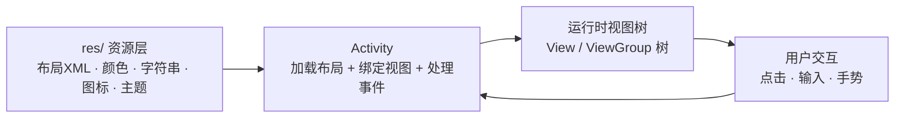
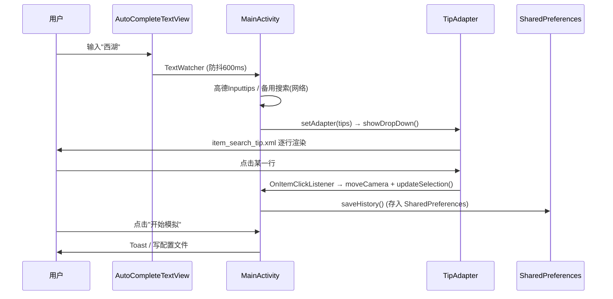

# 以 GlobalTraveling (Shadow) 为示范案例 —— 安卓 App 前端实现教程

> 本项目虽然核心是 Xposed 虚拟定位模块，但它的 **Activity 前端**（地图选点 + 搜索 + 历史记录 + 弹窗）
> 覆盖了安卓传统 UI 的六大核心板块：布局、资源、事件、适配器、对话框、主题。
> 本文以项目真实代码为案例，带你从零到一系统学习安卓前端实现。

---

## 一、安卓前端的全景图

安卓传统 UI（本项目采用的方式）由三层构成：



- **XML 描述"长什么样"**（声明式）
- **Java 决定"怎么动"**（命令式）
- 两者通过 **`R.id.xxx`** 这个桥梁连接

本项目对应文件：

| 职责 | 文件 |
|---|---|
| 主界面布局 | `app/src/main/res/layout/activity_main.xml` |
| 弹窗布局 | `res/layout/dialog_api_key.xml` |
| 列表条目布局 | `res/layout/item_search_tip.xml` |
| 图标/背景 | `res/drawable/`（矢量图 + shape） |
| 主题 | `res/values/themes.xml` |
| 逻辑代码 | `MainActivity.java` |

---

## 二、XML 布局：界面是怎么"画"出来的

### 1. 三大基础布局

打开 `activity_main.xml`，整个界面就是**布局的嵌套**：

```xml
<ConstraintLayout ...>          ← 根容器：相对定位（推荐首选）

    <MapView ... />             ← 地图铺满全屏（最底层）

    <CardView ...>              ← 搜索气泡（悬浮在地图上方）
        <AutoCompleteTextView ... />
    </CardView>

    <HorizontalScrollView ...>  ← 历史记录横滑条
        <LinearLayout ... />    ← 水平排列 chips
    </HorizontalScrollView>

    <CardView ...>              ← 底部操作岛
        <LinearLayout orientation="vertical">   ← 纵向堆叠两行
            <LinearLayout orientation="horizontal">  ← 状态行
            <LinearLayout orientation="horizontal">  ← 按钮行
        </LinearLayout>
    </CardView>
</ConstraintLayout>
```

三种容器的分工（本项目全用到了）：

| 容器 | 特点 | 项目中的用法 |
|---|---|---|
| `LinearLayout` | 线性排列，靠 `orientation` + `layout_weight` 分配空间 | 底部按钮行：`layout_weight="1"` vs `"1.5"` 让"开始模拟"更宽 |
| `ConstraintLayout` | 相对定位，**扁平化**避免深层嵌套 | 根布局，用 `constraintTop_toBottomOf` 把历史条挂到搜索框下面 |
| `ScrollView` 家族 | 可滚动 | `HorizontalScrollView` 横向滑动历史记录 |

### 2. 关键属性速读（以搜索框为例）

```xml
<AutoCompleteTextView
    android:id="@+id/et_search"                    ← 唯一ID，Java 里 findViewById 用它
    android:layout_width="match_parent"            ← 宽度：填满父容器（wrap_content=自适应）
    android:layout_height="match_parent"
    android:hint="搜索地点"                         ← 占位提示文字
    android:drawableStart="@drawable/ic_search_line" ← 左侧图标
    android:textSize="15sp"                        ← 字号用 sp（随系统字体缩放）
    android:background="@android:color/transparent"/> ← 透明背景（圆角由外层 CardView 提供）
```

**dp vs sp**：尺寸用 `dp`（与屏幕密度无关），文字用 `sp`（还响应用户字体大小设置）——这是无障碍要求。

### 3. CardView 做"卡片圆角"是安卓惯用套路

```xml
<androidx.cardview.widget.CardView
    app:cardCornerRadius="25dp"      ← 圆角
    app:cardElevation="4dp"          ← 阴影，产生悬浮感
    app:cardBackgroundColor="#F0F7FF">
```

搜索框本身是直角的 `AutoCompleteTextView`，圆角和阴影全靠外层 CardView——
**容器负责美观，内容控件负责功能**。

---

## 三、资源系统 `res/`：不硬编码的工程习惯

### 1. drawable：XML 即图形

`bg_search_dropdown.xml` — 用 `<shape>` 画"白底圆角+描边"，不用切图：

```xml
<shape android:shape="rectangle">
    <solid android:color="#FFFFFF" />
    <corners android:radius="14dp" />
    <stroke android:width="1dp" android:color="#E3EDF9" />
</shape>
```

`ic_search_line.xml` — **矢量图**（VectorDrawable），任意分辨率不糊、体积只有几百字节，
是现代安卓图标的标配。

### 2. 主题 themes.xml

```xml
<style name="Theme.Irest" parent="Theme.Material3.DayNight.NoActionBar">
    <item name="android:statusBarColor">@android:color/transparent</item>
    <item name="android:windowLightStatusBar">true</item>
</style>
```

- `DayNight`：自动适配深色模式
- `NoActionBar`：不要顶部标题栏（因为界面是全屏地图）
- 在 `AndroidManifest.xml` 里通过 `android:theme` 挂到整个 App

> ⚠️ 实战坑（本项目踩过）：M3 主题下如果强行叠加 M2 样式的弹窗、
> 或用 `createConfigurationContext` 强制浅色再建弹窗，会直接闪退。
> **主题必须统一，想要什么外观在 show 之后重绘**（见后面"对话框"一节）。

### 3. 布局复用与"字符串抽取"

- `item_search_tip.xml` 是**列表条目模板**，会被 `LayoutInflater` 反复膨胀成每一行；
- 硬编码文字本项目出于个人项目便利直接写了 `android:text="..."`，正式项目应抽取到
  `values/strings.xml`（`@string/xxx`）以便多语言。

---

## 四、Activity：把 XML 和 Java 接起来

`MainActivity.java` 的 `onCreate` 是每个页面的起点，本项目展示了一个典型启动序列：

```java
@Override
protected void onCreate(Bundle savedInstanceState) {
    // ① SDK 合规初始化（必须最早）
    MapsInitializer.updatePrivacyShow(this, true, true);
    // ② 沉浸式状态栏（透明 + 黑图标）
    getWindow().setStatusBarColor(Color.TRANSPARENT);
    // ③ 加载 XML 布局 → 生成视图树
    setContentView(R.layout.activity_main);
    // ④ 业务初始化
    if (checkDisclaimer()) initApp();
}
```

在 `initApp()` 里可以看到标准三板斧：

```java
tvStatus = findViewById(R.id.tv_status);   // 找到控件
mapView.onCreate(savedState);              // 第三方视图的生命周期托管
findViewById(R.id.btn_start).setOnClickListener(v -> { ... });  // 绑事件
```

**生命周期要点**（地图这类控件尤其重要）：
`onCreate → onStart → onResume → onPause → onDestroy`，
`MapView` 必须一一转发（项目里用了 `savedState` 做状态恢复，旋转屏幕不丢状态）。

---

## 五、事件交互：用户操作如何驱动代码

### 1. 点击事件 + Toast 反馈

```java
findViewById(R.id.btn_start).setOnClickListener(v -> {
    if (selectLat == 0) {
        Toast.makeText(this, "请先在地图上长按或搜索选点", Toast.LENGTH_SHORT).show();
        return;
    }
    writeToSystemTmp(...);   // 真正的业务动作
});
```

模式永远是：**校验 → 反馈（Toast）→ 执行**。

### 2. 文本监听 + 防抖（搜索框核心技巧）

```java
etSearch.addTextChangedListener(new TextWatcher() {
    @Override public void afterTextChanged(Editable s) {
        if (searchRunnable != null) searchHandler.removeCallbacks(searchRunnable); // 取消上一次
        searchRunnable = () -> { /* 真正发起搜索 */ };
        searchHandler.postDelayed(searchRunnable, 600);   // 停止输入 600ms 才执行
    }
});
```

没有防抖的话，每敲一个字母就发一次网络请求——既费流量又会被接口限流。
这是**所有搜索框的必备写法**。

### 3. 长按、地图手势

```java
tvStatus.setOnLongClickListener(v -> { showApiKeyDialog(); return true; });
aMap.setOnMapLongClickListener(latLng -> updateSelection(...));
```

返回 `true` 表示"事件已被我消费，别再往下传了"。

---

## 六、适配器模式：下拉搜索建议的灵魂

`AutoCompleteTextView` + 自定义 `TipAdapter` 是本项目最"教科书"的一段：

```java
private class TipAdapter extends ArrayAdapter<Tip> {
    @Override public View getView(int position, View convertView, ViewGroup parent) {
        return buildRow(position, convertView, parent);          // 输入框内的当前文本
    }
    @Override public View getDropDownView(...) { return buildRow(...); }  // 下拉列表每一行

    private View buildRow(int position, View convertView, ViewGroup parent) {
        View view = convertView;
        if (view == null) {   // ← convertView 复用：滑动时不再重复 inflate，防卡顿
            view = LayoutInflater.from(getContext()).inflate(R.layout.item_search_tip, parent, false);
        }
        Tip tip = getItem(position);
        view.findViewById(R.id.tip_title).setText(tip.getName());  // 绑定数据到视图
        ...
        return view;
    }
}
```

要点：

1. **数据（Tip）→ 布局（item_search_tip.xml）→ 视图行** 的映射；
2. `convertView == null` 才膨胀布局——这就是著名的 **ViewHolder/回收复用机制**
   （RecyclerView 也是同一思想）；
3. 数据到达后 `etSearch.setAdapter(...)` + `showDropDown()` 刷新。

---

## 七、动态构建视图：`addHistoryChip()`

历史记录的条目数量不确定，所以不能写死在 XML 里，而是在 Java 中**程序化造控件**：

```java
private void addHistoryChip(String name, double lat, double lng) {
    CardView card = new CardView(this);                 // new 出来
    card.setRadius(dp2px(20));                          // 代码里也要做单位换算！
    card.setCardBackgroundColor(Color.parseColor("#F0F7FF"));
    LinearLayout layout = new LinearLayout(this);        // 内部横向排布
    TextView tv = new TextView(this);                    // 标题（可点击→定位）
    TextView btnDel = new TextView(this);                // "✕"（可点击→删除）
    tv.setOnClickListener(v -> updateSelection(lat, lng, name));
    layout.addView(tv); layout.addView(btnDel);
    card.addView(layout);
    historyContainer.addView(card);                     // 挂到 XML 里的容器上
}
```

配套的 `dp2px` 工具：

```java
private int dp2px(float dp) {
    return Math.round(dp * getResources().getDisplayMetrics().density);
}
```

> 经验法则：**数量固定用 XML，数量动态用代码**（或进阶后用 RecyclerView + ListAdapter）。

---

## 八、对话框：自定义布局弹窗的完整流程

`showApiKeyDialog()` 是"AlertDialog + 自定义视图"的标准示范：

```java
View view = LayoutInflater.from(this).inflate(R.layout.dialog_api_key, null); // 膨胀自定义内容
EditText input = view.findViewById(R.id.et_api_key);                           // 在弹窗视图里找控件
AlertDialog dialog = new MaterialAlertDialogBuilder(this)
        .setTitle("设置高德地图 API Key")
        .setView(view)                                   // ← 挂上自定义布局
        .setPositiveButton("保存", (d, which) -> { ... }) // ← lambda 处理按钮
        .create();
dialog.show();
forceDialogWhite(dialog);   // show() 之后才能拿到内部控件做重绘
```

`forceDialogWhite()` 值得精读——它浓缩了本项目的实战经验：

```java
Window window = dialog.getWindow();
window.setBackgroundDrawable(bg);                                    // 直接换窗口背景为白色圆角
TextView title = dialog.findViewById(com.google.android.material.R.id.alertTitle); // M3 标题ID不是 android.R.id.title！
title.setTextColor(...);
dialog.getButton(AlertDialog.BUTTON_POSITIVE).setTextColor(...);      // 按钮颜色在 show 后才可设
```

**为什么必须 show 之后操作**：
`getButton()`、`findViewById(内部控件)` 在 `show()` 前返回 null；
窗口背景属于 `Window`，也要对话框附着后才存在。

**更多弹窗实战坑**（本项目验证过的结论）：

- `MaterialAlertDialogBuilder` 叠 M3 overlay 到 M2 主题 → inflate 闪退；
- 覆盖 `colorSurface` 想改弹窗底色 → 无效（属性穿不透样式链）；
- 可靠方案：正常 create/show 后直接重绘窗口背景 + 重设文字/按钮颜色；
- `TextInputEditText` 不写 `android:textColor` 会跟随主题（深色模式下白字），
  白底弹窗里必须显式指定深色。

---

## 九、一个完整交互的串讲（把所有知识点连起来）

以「用户搜索"西湖"并开始模拟」为例：



---

## 十、学习路线与练习建议

**按顺序精读本项目文件**：

1. `activity_main.xml` → 掌握容器嵌套与约束
2. `MainActivity.onCreate/initApp` → 掌握绑定与事件
3. `TipAdapter` → 掌握适配器与视图复用
4. `addHistoryChip` → 掌握动态视图
5. `showApiKeyDialog/forceDialogWhite` → 掌握弹窗与主题坑

**动手练习（由易到难）**：

1. 把界面颜色抽到 `values/colors.xml`，按钮文字抽到 `strings.xml`；
2. 给底部操作岛加一个"清空历史"按钮（练 XML + 点击事件 + 弹窗确认）；
3. 把历史 chips 改成 `RecyclerView`（进阶：列表复用机制）；
4. 用 Jetpack **ViewBinding** 替换全部 `findViewById`（现代标准写法）；
5. 远期：学习 **Jetpack Compose**——安卓新一代声明式 UI，将取代 XML
   （但 XML 仍是读懂存量项目的必备技能）。
